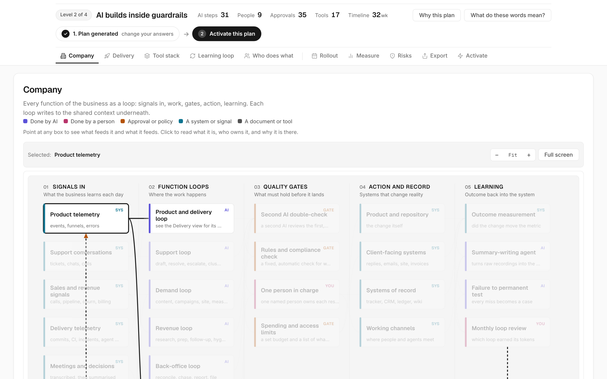
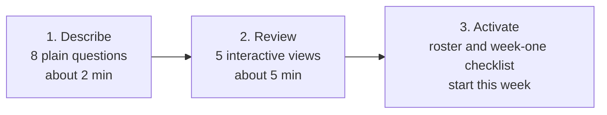

<div align="center">

# AI-Native Flow

**Answer 8 questions. Get a complete plan for running your business with AI.**

A free, instant blueprint: what to automate, who still decides, which tools to use, and what to build first.
No sign-up. No servers. No AI guesswork: the same answers always give the same plan.

[**Open the live app**](https://exponen-agi.github.io/ai-native-flow/) · [How it works](docs/METHOD.md) · [Architecture](docs/ARCHITECTURE.md) · [Contributing](docs/CONTRIBUTING.md)

[](https://exponen-agi.github.io/ai-native-flow/)
[](https://github.com/exponen-agi/ai-native-flow/actions/workflows/pages.yml)


[](#license)

<a href="https://exponen-agi.github.io/ai-native-flow/"></a>

</div>

---

## Table of contents

- [What and why](#what-and-why)
- [Key features](#key-features)
- [How it works](#how-it-works)
- [The five views](#the-five-views)
- [Architecture](#architecture)
- [Quick start](#quick-start)
- [Repository structure](#repository-structure)
- [Documentation](#documentation)
- [Contributing](#contributing)
- [License](#license)

## What and why

Companies buy AI seats, hand them to the tech team, and speed up the one step that was never the
bottleneck. Writing gets faster, but planning, review and release still move at human speed, so
results barely change and nobody knows why.

**AI-Native Flow designs the whole operation around AI, not just the tools inside it.** You describe
your business in eight plain questions; it returns a blueprint of the loops that should run, the
approval gates where people still decide, a tool for each slot at your stage, and the order to build
it in.

## Key features

- **Deterministic.** Rules, not a chatbot. Same answers, same blueprint; it cannot invent roles.
- **Private.** Runs entirely in your browser. Nothing is sent, stored or tracked.
- **Free to run.** One static page: no backend, no API keys, no bill.
- **Five interactive views** of one plan, cross-linked so a rollout step opens the part it names.
- **A plan to act on.** The build order, the metrics to watch, and the failure patterns that match your situation, plus a roster and week-one checklist.
- **Bring your own AI.** One click exports your plan with a critique prompt to refine in the assistant you already use.
- **Easy to extend.** Every step, tool and rule is one small object in the knowledge base. No build to run.

## How it works



| Step | What you do | Time |
| --- | --- | --- |
| **Describe** | Business type and size, industry, what you sell, stage, main problem, tech team, budget | ~2 min |
| **Review** | Explore your plan as interactive diagrams | ~5 min |
| **Activate** | Copy the checklist and start this week | instant |

## The five views

| View | The question it answers |
| --- | --- |
| **Company** | Which parts of the business run as loops, and where do people approve? |
| **Delivery** | How does an idea become shipped work, step by step? |
| **Tool stack** | Which tool fills each slot at your stage, and how does its data flow back? |
| **Learning loop** | How does finished work make the next job better? |
| **Who does what** | Which roles are AI agents, which are people, and what passes between them? |

See [docs/VIEWS.md](docs/VIEWS.md) for how to read each one.

## Architecture

There is no model call and no server. A fixed rule engine turns the answers into a blueprint, and
plain-JavaScript renderers draw it.

```mermaid
flowchart TD
    form["Intake form<br/>app.js"] -->|answers| profile["profile.js<br/>maps answers onto rule segments"]
    profile --> engine["engine.js<br/>tier, node selection, bridging,<br/>metrics, risks"]
    kb["kb.js and kb-company.js<br/>knowledge base"] --> engine
    engine --> views["engine-views.js<br/>four lane views, tool picks,<br/>company rollout"]
    views --> graph["graph.js<br/>Company, Delivery, Tool stack,<br/>Learning loop"]
    views --> network["network.js<br/>Who does what"]
    views --> activate["activate.js<br/>roster, first week, checklist"]
```

Why no LLM call, the tier model and the design decisions are covered in
[docs/ARCHITECTURE.md](docs/ARCHITECTURE.md) and [docs/METHOD.md](docs/METHOD.md).

## Quick start

Use the [live app](https://exponen-agi.github.io/ai-native-flow/), open `index.html` in a browser, or serve it locally.

```sh
git clone https://github.com/exponen-agi/ai-native-flow.git
cd ai-native-flow

python3 -m http.server 8000   # then visit http://localhost:8000
# or
npm start                     # npx serve on http://localhost:4321

npm test                      # validate files, JS syntax and the blueprint engine
```

Fonts load from Google Fonts; everything else is local, so the app falls back to system fonts offline.

## Repository structure

```text
.
├── index.html              # page structure and the intake form
├── assets/
│   ├── css/app.css         # design tokens and all styles, both themes
│   └── js/
│       ├── profile.js      # business types, sizes, stages, industries
│       ├── kb.js           # delivery knowledge base
│       ├── kb-company.js   # company loops, tool catalogue, learning-loop stages
│       ├── engine.js       # tier derivation, node selection, metrics, risks
│       ├── engine-views.js # builds the lane views, picks tools, schedules rollout
│       ├── graph.js        # layered SVG renderer for the four lane views
│       ├── network.js      # "who does what" view
│       ├── activate.js     # roster, first week, checklist
│       ├── peek.js         # side sheet for any part of the plan
│       └── app.js          # tabs, intake, detail panel, export, URL state
├── docs/                   # method, views, architecture, contributing, landscape
├── scripts/validate.js     # backs `npm test` and `npm run build`
└── .github/workflows/      # GitHub Pages deployment
```

## Documentation

| Document | What it covers |
| --- | --- |
| [docs/VIEWS.md](docs/VIEWS.md) | What each tab shows and how to read it |
| [docs/METHOD.md](docs/METHOD.md) | How the blueprint is derived: the rules and the sources behind them |
| [docs/ARCHITECTURE.md](docs/ARCHITECTURE.md) | How the code is organised and why it is static |
| [docs/CONTRIBUTING.md](docs/CONTRIBUTING.md) | Run it locally, deploy it, extend the knowledge base |
| [docs/LANDSCAPE.md](docs/LANDSCAPE.md) | The tools the catalogue covers, with a monthly review log |

## Contributing

Every step, tool and rule is one small object in `assets/js/kb.js` and `assets/js/kb-company.js`.
Add one, reload the page; there is nothing to build. See
[docs/CONTRIBUTING.md](docs/CONTRIBUTING.md#extending-the-knowledge-base) for the format, and run
`npm test` before opening a PR. Deployment to GitHub Pages is described in
[docs/CONTRIBUTING.md](docs/CONTRIBUTING.md#deploying-to-github-pages).

## License

MIT, as declared in [`package.json`](package.json).
